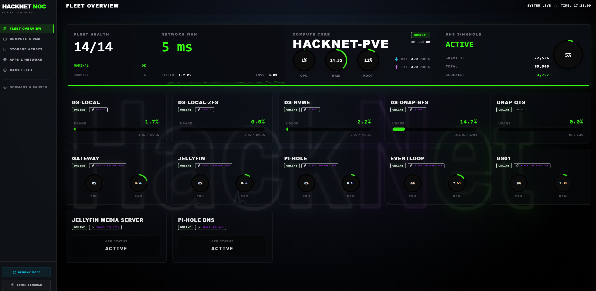

# HackNet NOC v3.0.0
**A lightweight, headless monitoring dashboard built for homelabs.**



I've spent the last few months building HackNet NOC. It started out as a custom monitor just for my own homelab, and after a lot of adapting and rewriting, it evolved into a fully-fledged, enterprise-grade open-source dashboard.

The goal was simple: I wanted a unified view of my Proxmox nodes, VMware ESXi hosts, NAS storage (TrueNAS/Synology/QNAP), Docker containers, Pterodactyl game servers, and media services. But I *didn't* want to spin up a massive, heavy stack with PostgreSQL or Redis just to do it.

HackNet runs on a fast Python/FastAPI backend with a local SQLite database. It's super light on resources, incredibly easy to deploy, and actually enjoyable to use.

---

## ✨ Why I built this (and what makes it different)

* **Root Cause Analysis (No Alert Spam):** If a physical Proxmox host crashes, HackNet automatically links the dependent VMs and Docker containers to it. You get *one* critical alert for the host, instead of a massive flood of notifications for every single offline child service.
* **Auto-Discovery:** I hate managing massive `.env` files. Just plug your API tokens into the Web UI during setup, and the app will automatically scan and map out your nodes, VMs, storage pools, and containers.
* **Mobile-Friendly Action Center:** The desktop view gives you a dense data-grid for deep configuration. If you open it on your phone, it automatically morphs into a streamlined "Action Center" so you can quickly pause sensors or mute global sirens on the go.
* **Anti-Flapping:** Built-in micro-retries for network checks ensure you don't get spammed on Discord or Telegram just because your network had a 2-second ping spike. 
* **Custom Pinned HUD:** You can pin the two infrastructure categories you care about most permanently to the top of your dashboard.
* **Daily Briefings:** It compiles a clean infrastructure status summary and fires it off to your Telegram or Discord at 08:00 and 20:00 every day.

---

## 🏗️ Where to host this

**Best Practice:** It is highly recommended to run this on a separate, dedicated device (like a Raspberry Pi, an old mini-PC, or a cheap VPS). 

*Do not host HackNet on the exact server it is supposed to be monitoring.* If your main hypervisor loses power or crashes, HackNet will go down with it, and it won't be able to send you the offline alert!

---

## 🚀 Installation

### Option A: Docker (Highly Recommended)

Deploying via Docker is the cleanest method. You don't even need to download the source code; Docker will just pull the pre-built image directly from GitHub.

1. Create a `docker-compose.yml` file anywhere on your system:
   ```yaml
   services:
     noc-api:
       image: ghcr.io/cbiscuit456/hacknet-noc:latest
       container_name: hacknet-noc-api
       restart: unless-stopped
       ports:
         - "8000:8000"
       volumes:
         - ./data:/app/data

     noc-collector:
       image: ghcr.io/cbiscuit456/hacknet-noc:latest
       container_name: hacknet-noc-collector
       restart: unless-stopped
       volumes:
         - ./data:/app/data
       command: python collector.py
       depends_on:
         - noc-api
   ```
2. Start the application:
   ```bash
   docker-compose up -d
   ```
3. Navigate to `http://<your-ip>:8000` in your browser to begin the Setup Wizard.

### Option B: Bare Metal / Raspberry Pi OS (One-Liner)

If you prefer to run this directly on a Debian/Ubuntu-based system (or Raspberry Pi OS) without Docker, you can use the automated bash installer.

Just paste this into your terminal:
```bash
curl -sSL https://raw.githubusercontent.com/CBiscuit456/hacknet-noc/master/install.sh | sudo bash
```
*This script installs the required dependencies, clones the app to `/opt/hacknet-noc`, sets up the Python environment, and starts the background systemd services automatically.*

---

## ⚙️ Initial Setup

When you visit the dashboard for the first time, the **Web Setup Wizard** will guide you through the process. You'll be asked to provide:
* A Master Password (which securely encrypts your configuration and API keys in the database).
* Your Core WAN Routing IP (so the app knows if your actual ISP is down, vs just a local network issue).
* Your Integration URLs and API Tokens.
* Your Telegram Bot / Discord Webhook URL for alerting.

---

## 🔄 Updating HackNet NOC

Updates are non-destructive. Your historical data and configurations will stay perfectly safe in your `data` directory.

**To update via Docker:**
```bash
docker-compose pull
docker-compose up -d
```

**To update via Bare Metal:**
Simply re-run the installation one-liner. It will detect the existing app at `/opt/hacknet-noc`, pull the latest code, and restart the services automatically.
```bash
curl -sSL https://raw.githubusercontent.com/CBiscuit456/hacknet-noc/master/install.sh | sudo bash
```

---

## 🛠️ Operations & Troubleshooting

* **Admin Panel:** Go to `http://<your-ip>:8000/admin` to trigger manual network polls, force status reports, update API keys, map custom ping/TCP sensors, or mute global sirens.
* **Accurate Proxmox RAM:** By default, Proxmox only reports the *allocated* RAM of a VM. To see the *true* RAM usage on your dashboard, enable the "QEMU Guest Agent" in your Proxmox VM hardware options, and install the agent inside the guest OS (`sudo apt install qemu-guest-agent`).
* **Database Maintenance:** The system handles its own database cleanup. It automatically prunes metrics older than 7 days and event logs older than 30 days to keep the database small and fast.

---

## 🗑️ Uninstalling

If you ever need to remove HackNet NOC, here is how to do it cleanly without leaving junk files behind.

**If deployed via Docker:**
```bash
# Spin down containers and remove orphaned volumes
docker-compose down -v --remove-orphans

# Delete the associated Docker images
docker rmi ghcr.io/cbiscuit456/hacknet-noc:latest

# Remove persistent data
sudo rm -rf data/ docker-compose.yml
```

**If deployed via Bare Metal:**
```bash
# Stop and disable the background services
sudo systemctl stop hacknet-api hacknet-collector
sudo systemctl disable hacknet-api hacknet-collector

# Delete the systemd service files and reload the daemon
sudo rm /etc/systemd/system/hacknet-api.service
sudo rm /etc/systemd/system/hacknet-collector.service
sudo systemctl daemon-reload

# Wipe the application directory
sudo rm -rf /opt/hacknet-noc/
```


